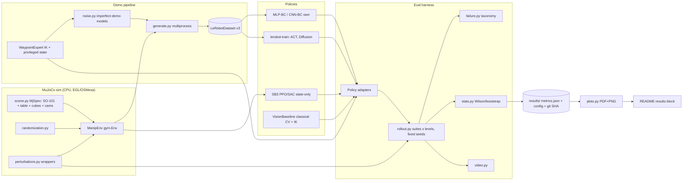

# Project plan: sim manipulation (P6)

> Step 5 amendments that apply to this project, followed by Appendix C of the approved implementation plan, verbatim.

### Step 5 — Project 6: sim manipulation (Appendix C, phases 1–7)

Phase 0 was done in Step 2. Implement Appendix C with these amendments:
- `lerobot==0.7.0` with extras `dataset,training,diffusion` (0.7.1 is unreleased); torch/torchvision per Step 1 extras (2.14 / 0.29 satisfy lerobot's `<2.16` / `<0.30`); numpy stays `<2.3`.
- `mujoco>=3.3,<4` and `mujoco-menagerie==2026.11.3`. If the SO-101 XML fails to load or compile under 3.x, switch to `mujoco==4.0.1` and record an ADR.
- `stable-baselines3==2.9.2`.
- E3 MVP variants (4): chunk ∈ {1, 10, 50} with VAE on, plus chunk 50 with VAE off. Backbone pretrained/scratch and camera ablations are stretch.
- E7 MVP uses SAC only (3 seeds, Reach + PickLift, budgets as in Appendix C); PPO is stretch. The RL smoke test and `train_rl.py --algo` accept only `sac` in MVP.
- If Step 2 yielded Outcome B, run the Kaggle reduced grid via `notebooks/kaggle_train.ipynb`: clone the repo; keep Kaggle's preinstalled CUDA torch; `pip install "lerobot[dataset,training,diffusion]==0.7.0" && pip install -e . --no-deps`; upload the locally generated datasets as a private Kaggle dataset and point `--dataset.root` at it; run `python -m simmanip.train.run_train` for the run_ids listed in a `queue.txt` cell; write checkpoints to `/kaggle/working/checkpoints/<run_id>`. Download checkpoints and evaluate locally (eval is CPU-bound). If Kaggle's torch violates lerobot's `<2.16` pin, `pip install "torch==2.14.*" "torchvision==0.29.*" --index-url https://download.pytorch.org/whl/cu126` first (CUDA wheel tag unverified — confirm first; use whichever `cu1xx` index lists 2.14).
- Disk cap 25 GB with keep-set checkpoint pruning. E8 latency bench uses the exclusive lock; training sweeps and RL use the shared lock.


## Appendix C — Project 6 spec (RobotManipPlanner)

### Project 6 — `sim-manipulation`: Robotic Manipulation Through Simulation and Learned Control

Repo: `aryanbarik/sim-manipulation`. Directory: `/home/aryan/Code/sim-manipulation`. Python package: `simmanip`.

#### 1. Scope & architecture

**One-line scope.** A controlled, reproducible study of how learned manipulation policies scale with data, architecture, task complexity and environmental variation. It runs on a simulated SO-101 arm in MuJoCo. It compares classical control, state-based BC, pixel BC, ACT, Diffusion Policy and a small RL baseline. The study ends with a quantitative sim-to-real feasibility analysis.

**Decisions that challenge the brief (final, no open questions):**

1. **Build my own MuJoCo env on the Menagerie SO-101; do not adopt a benchmark suite.**
   - The Menagerie model `robotstudio_so101` exists (Apache-2.0, MuJoCo ≥3.1.3, 6 actuated DoF, primitive collision geoms, a camera mount). Source: https://github.com/google-deepmind/mujoco_menagerie and its `robotstudio_so101/README.md`.
   - SO-101 is the arm the user could later buy. The BOM is in the SO-ARM100 README.
   - The study needs knobs that benchmark envs don't expose: per-episode friction, mass, PD gain, camera and light randomization; observation noise; action delay; distractors; and demo-noise models. These are first-class here.
   - Rejected alternatives:
     - ManiSkill3: its GPU sim is Linux+NVIDIA only. The support table lists "Windows/AMD GPU: CPU sim yes, GPU sim no", and Linux+AMD is not listed (https://maniskill.readthedocs.io/en/latest/user_guide/getting_started/installation.html).
     - robosuite, LIBERO, MetaWorld: Franka/Sawyer arms and fixed tasks, with no SO-101 match.
     - gym-aloha and gym-pusht: wrong embodiment.
     - MimicGen: our scripted expert already generates unlimited demos.
2. **Prior art exists, so differentiation comes from rigor and breadth, not from the env.**
   - `aviadarn/so101-lerobot`: ACT on SO-101 pick-place, a 25–300-demo sweep, and a negative curation result.
   - `johnsutor/so101-nexus`: a full stack with PPO.
   - `isaka1022/so101-sim2real`: a `lerobot_env_*` plugin.
   - None of them has the following (see §3):
     - a multi-architecture × multi-task × perturbation grid;
     - classical baselines;
     - imperfect-demo noise models;
     - latency analysis;
     - Wilson/bootstrap statistics;
     - a failure taxonomy.
3. **IL core; RL is a small state-only baseline, in MVP.**
   - PPO/SAC on Reach and PickLift (state obs, CPU, SB3) gives the RL reference line for the sample-efficiency chart.
   - Residual RL on BC is stretch.
   - RL on pixels or on PickPlace is out of scope. CPU sim throughput can't support it, and ManiSkill/MJX GPU sim is unavailable on this AMD box.
4. **Policies.**
   - Own plain-PyTorch MLP-BC (state) and CNN-BC (pixels).
   - LeRobot ACT and Diffusion, trained with `lerobot-train`.
   - Reasons for using LeRobot's implementations:
     - they are maintained reference implementations of the architectures the brief asks about;
     - they use the standard dataset format, which is a resume talking point.
   - Reasons for the own baselines:
     - they are the "does architecture matter?" control;
     - they show I can implement BC from scratch.
   - VQ-BeT is stretch. It is in LeRobot and belongs to the light group at about 2–6 GB VRAM.
   - VLAs (pi0, SmolVLA) are rejected. LeRobot's hardware guide puts SmolVLA at ~10–16 GB peak VRAM at batch size 8 and large VLAs at 24–40 GB (https://huggingface.co/docs/lerobot/hardware_guide). That doesn't fit 12 GB with 3-seed grids, and VLAs aren't the study question.
5. **Evaluation does not use `lerobot-eval`.**
   - The harness needs custom suites, common random numbers, per-episode traces and failure labels.
   - LeRobot is used for datasets, policies and processors only.
6. **Observation/action contract matches LeRobot's SO-101** so the dataset schema could carry real data later. See `units.py` in Phase 1.

**Mermaid architecture:**



**Components:**

| Component | Role |
|---|---|
| Env | `ManipEnv` plus 4 tasks: Reach, PickLift, PickPlace, Stack (stretch) |
| Randomization | Per-episode model edits, 3 levels |
| Perturbations | Eval-time wrappers |
| Experts | Privileged waypoint expert; classical vision+IK baseline |
| Demo generator | Multiprocess, writes LeRobotDataset v3 |
| Training | Own MLP/CNN-BC, `lerobot-train` wrapper for ACT/Diffusion, SB3 RL |
| Eval | Suites, CRN seeds, stats, failure taxonomy, video, latency bench |
| Sweep runner | Resumable |
| Analysis | Aggregate, plots, README results script |
| Docs | ADRs, sim-to-real report |

#### 2. Literature & existing implementations

| Source | URL | Take / avoid |
|---|---|---|
| ACT (Zhao et al., ALOHA) | LeRobot ACT docs https://huggingface.co/docs/lerobot/act | Take: action chunking and CVAE, with chunk-size and VAE ablations. |
| Diffusion Policy (Chi et al.) | https://diffusion-policy.cs.columbia.edu | Take: conditional action diffusion. Use the DDIM-step vs latency trade-off. Use EMA weights (LeRobot `--ema.type=warmup`, from the Diffusion README). |
| LeRobot 0.7.1 | https://github.com/huggingface/lerobot | Take: policies, LeRobotDataset v3, image transforms (ColorJitter, GaussianNoise, etc.). Avoid its eval and env stack. |
| LeRobotDataset v3 | https://huggingface.co/docs/lerobot/lerobot-dataset-v3 | Format: Parquet + MP4, `meta/info.json`, `meta/stats.json`, `meta/tasks.parquet`. You must call `dataset.finalize()`. |
| LeRobot hardware guide | https://huggingface.co/docs/lerobot/hardware_guide | Compute anchors (see §5). Training converges in ~5–10 epochs. |
| MuJoCo Menagerie | https://github.com/google-deepmind/mujoco_menagerie | Take: `robotstudio_so101` and `mujoco-menagerie==2026.9.0` (PyPI, pinned in its README). |
| SO-ARM100 | https://github.com/TheRobotStudio/SO-ARM100 | Take: BOM, STS3215 torque specs, kit vendors, for the sim-to-real analysis. |
| aviadarn/so101-lerobot | https://github.com/aviadarn/so101-lerobot | Take: its findings that loss and success decouple (so evaluate rollouts) and that curated demos are less diverse (so don't curate by typicality). Avoid: single task, single policy, no seeds ≥3, no perturbation study. |
| so101-nexus | https://github.com/johnsutor/so101-nexus | Cite as alternative. Avoid copying its randomised wrist-FOV, which hurts fine alignment per the aviadarn README. |
| isaka1022/so101-sim2real | https://github.com/isaka1022/so101-sim2real | Take: its warning that top-down grasp is hard for SO-101's IK, so use angled approaches. |
| TheRock SUPPORTED_GPUS | https://github.com/ROCm/TheRock/blob/main/SUPPORTED_GPUS.md | gfx1031 is Linux Release Ready. |
| rx6700xt-local-ai | https://github.com/markb-1/rx6700xt-local-ai | Take: fp16 GEMM ≈21 TFLOPS, bf16 has no hardware support (use fp16), and MIOpen grouped-conv kernels are missing for gfx1031. Evidence is Windows only; Linux torch is listed as "untested". |

#### 3. Differentiation

This is not a tutorial because:
- it runs a pre-registered grid, not one training run;
- every number has a CI;
- classical, imitation and RL baselines run in one harness on common random numbers;
- the failure modes are classified, not just counted.

**Headline questions the design can answer:**

1. **Q1 (data × complexity × architecture).** Does the data-efficiency gap between ACT/Diffusion and MLP/CNN-BC grow with task horizon (Reach → PickLift → PickPlace)? How many demos does each policy need for 50% and 80% success?
2. **Q2 (what buys robustness).** Do action chunking and diffusion buy robustness to observation noise, physics shift and imperfect or multimodal demos, or only nominal success? What does the success vs p99 latency vs training-GPU-hour Pareto front look like?
3. **Q3 (where variation hurts).** Which variation axis dominates failure: camera pose, lighting, physics, delay, or distractors? Is training with broad domain randomization worth more than 2× more nominal demos?
4. **Q4 (IL vs RL).** On Reach and PickLift, at what env-interaction budget does state-only RL match IL trained on N demos?

#### 4. Technology selection

| Choice | Justification | Rejected |
|---|---|---|
| Python 3.12, uv, ruff, pytest | Repo convention. LeRobot requires ≥3.12 (verified in its `pyproject.toml`). | — |
| `lerobot==0.7.1` with extras `dataset,training,diffusion` | The version in the repo's `pyproject.toml` on main. Torch pin is `>=2.7,<2.16`, which is compatible with the 2.11–2.14 ROCm wheels. PyPI availability of 0.7.1: unverified — confirm first. Fallback: pin the git SHA. | pip-install unpinned |
| torch via TheRock multi-arch wheels | Install: `torch[device-gfx1031]` from `https://nightly.repo.amd.com/rocm/whl-next/` (from Main's verification). CI uses CPU torch from PyPI. The `cpu`/`rocm` extras are declared in `[tool.uv] conflicts`. | HSA_OVERRIDE with older ROCm (kept as fallback), CUDA |
| MuJoCo (pin at lock time) | Exact version: unverified — confirm first; take whatever `uv lock` resolves, then pin. Menagerie requires ≥3.1.3. | Isaac, MJX/Warp (CUDA-oriented) |
| `mujoco-menagerie==2026.9.0` | Pinned by its README. | Copying XML by hand |
| gymnasium ≥1.1.1 | Dependency of LeRobot. | — |
| Stable-Baselines3 (SAC/PPO) | Mature, so RL isn't the point. Version unverified — confirm first. | CleanRL, own RL |
| Own MLP/CNN-BC in torch | Controls for the "does architecture matter" question. | — |
| matplotlib, pandas, scipy | Analysis. Wilson CI via `scipy.stats.binomtest(...).proportion_ci(method="wilson")` or a manual formula. | seaborn |
| pydantic v2 + PyYAML | Config. | Hydra (extra magic) |
| Rendering | `MUJOCO_GL=egl` (Mesa radeonsi), fallback `osmesa`. Chosen by the Phase 0 benchmark. | GLFW |

**Dependency risk:** torchcodec doesn't declare its torch dependency and LeRobot caps it at `<0.18`. The Phase 0 spike tests video decode. Fallback is `--dataset.video_backend=pyav` (unverified — confirm the flag name), then image storage.

#### 5. Data & compute

**Datasets: all generated locally. No external data.**

| Dataset | Source | Size |
|---|---|---|
| `pickplace_expert` (400 eps, nominal) | `simmanip.data.generate` | ~1–2 GB (MP4, 128×128 × 2 cams) |
| `pickplace_dr_{low,high}` (N=100 each) | same | ~0.5 GB |
| `pickplace_noisy_{s1,s2}`, `_mixed_fail`, `_multimodal` (N=100 each) | same | ~2 GB |
| `pickup_lift`, `reach` (≤200 eps) | same | ~0.5 GB |

- Nested subsets are taken by episode index.
- Frame budget: 30 Hz control, ≤10 s episodes (≤300 steps), typical expert episode ~150 steps. 400 eps ≈ 60k frames.
- Datasets stay local (`dataset.root`), not pushed to the Hub. Pushing is optional stretch.

**Disk budget (target ≤25 GB, cap 30 GB):**

| Item | GB |
|---|---|
| Python env + uv cache (ROCm torch is large; unverified — measure with `du` in Phase 0) | ≤12 |
| Datasets | 6 |
| Kept checkpoints (weights only, fp16, ~20 "keep-set" runs) | 3 |
| Videos (selected episodes) | 3 |
| Results JSON / logs | 0.5 |
| **Total** | **~24.5** |

Policy: after a run's full eval suite finishes, delete non-keep-set checkpoints. The keep-set is the N=100 runs × 4 policies × 3 seeds.

**Hardware needs:**
- CPU: sim, data generation and eval use 5–6 worker processes (6 cores / 12 threads).
- RAM: <16 GB.
- VRAM: ≤12 GB. LeRobot's guide gives ACT ~2–6 GB and Diffusion ~8–14 GB peak at batch size 8 (indicative, from 640×480 inputs). At 128×128 inputs and a small U-Net this should fit, and Phase 0 measures it. If peak VRAM is above 11 GB, drop the Diffusion batch size and use gradient accumulation.

**Training-time planning numbers (extrapolations, not measurements).** The LeRobot guide gives, for ~45k frames at 640×480 on an RTX 4090/3090: ACT 5 epochs ≈ 30–60 min and Diffusion ≈ 2–4 h. Our images are ~19× smaller, but the RX 6750 XT is slower and not a tuned target. I plan with the following and replace them with Phase 0's measured steps/s:

| Policy | Budget per run | Planning time |
|---|---|---|
| MLP-BC (state) | 20k steps, CPU | ~5 min |
| CNN-BC (ResNet-18, pixels) | 20k steps, bs 64, fp16 | ~20 min |
| ACT | 20k steps, bs 32, fp16 | ~1 h |
| Diffusion | 30k steps, bs 32, fp16 | ~3 h |

**Grid GPU-hours:**

| Experiment | Runs | Hours |
|---|---|---|
| E1 CNN-BC, 6 N × 3 seeds | 18 | 6 |
| E1 ACT, 6 N × 3 seeds | 18 | 18 |
| E1 Diffusion, N ∈ {25,100,400} × 3 seeds | 9 | 27 |
| E2 (extra tasks) ACT, 2 tasks × 3 seeds | 6 | 6 |
| E3 ACT ablations, 6 variants × 3 seeds | 18 | 18 |
| E5 DR levels, 2 new × 3 seeds | 6 | 6 |
| E6 imperfect demos, 4 new × 3 seeds | 12 | 12 |
| Total train | | ≈ 93 |

- Eval is CPU-bound sim plus fast GPU inference: ~20k episodes ≈ 4–6 h wall on 5 workers (assuming 3–4 s per episode, unverified).
- RL (E7) is CPU: ~18 CPU-hours in the background.

**Local vs Kaggle:**
- Local: everything by default. The sweep runs as a resumable queue, about 4–5 days of wall time.
- Kaggle (free, ~30 GPU-h/week per shared context): Diffusion runs, if local ROCm is unstable. A T4 has 16 GB, and LeRobot lists "t4: ACT only" for HF Jobs. Diffusion on T4 is `unverified — confirm first`.
- Fallback grid if ROCm is unusable (~45 GPU-h): E1 Diffusion N ∈ {25,100}, E3 4 variants, E6 3 settings, seeds stay at 3.

**Financial cost: $0.**
- Optional paid, none required: Hugging Face Jobs (price unverified; `hf jobs hardware` lists it).
- Optional hardware only after the sim project completes. The SO-ARM100 BOM gives $229.88 (US) for parts for two arms (leader + follower) and $121.94 for a follower arm only. Source: https://github.com/TheRobotStudio/SO-ARM100. That excludes 3D printing, shipping, cameras and tax. Assembled-kit prices: unverified.

#### 6. Experimental design

**Fixed protocol**

- **Control:** 30 Hz. Physics timestep 1/300 s (10 substeps). Max episode 300 steps.
- **Action:** absolute joint-position targets (6-D).
- **Observation contract:**
  - `observation.state` (6)
  - `observation.environment_state` (8, privileged; used only by state policies and the expert)
  - `observation.images.front`, `observation.images.wrist` (128×128×3 uint8)
- **Units:** degrees for joints and a 0–100 gripper range, matching LeRobot's SO-101 convention. The exact convention is `unverified — confirm first` in `lerobot/robots/so_follower`; `units.py` is the only place it lives.
- **Seeds:**
  - Train demo seeds: 0–99,999.
  - Validation: 100,000+.
  - Test: 1,000,000+, disjoint.
- **Common random numbers:** every policy sees identical test initial conditions (same layout seeds, same perturbation draws).
- **Training seeds:** 3 per cell (0, 1, 2). Nested data subsets: the first N episodes.
- **Checkpoint rule:** the final checkpoint at a fixed step budget, never selected on test. A 30-episode validation suite is evaluated at 50% and 100% of the steps. Because loss and success decouple (aviadarn README), E1 N=100 runs additionally log val success every 5k steps for the "success vs training steps" curve.
- **Statistics:**
  - Per cell: 50 test episodes × 3 training seeds = 150 pooled episodes.
  - Report Wilson 95% CI on pooled episodes.
  - Report the between-seed mean ± 95% bootstrap (resampling seeds, then episodes).
  - Paired policy comparisons use a paired bootstrap on CRN episodes.
  - Report effect sizes with CIs and make no claims on non-overlapping noise.
  - Expected half-width at p=0.5 with n=150 is about ±8 points.

**Tasks and success definitions**

| Task | Success |
|---|---|
| T0 Reach | End-effector site within 1.5 cm of the target sphere for 10 consecutive steps. |
| T1 PickLift | Cube centre z ≥ table + 5 cm for 15 consecutive steps. |
| T2 PickPlace | Cube centre within 2.5 cm xy of the target-disc centre, resting (|v| < 2 cm/s), gripper open, held for 15 steps. |
| T3 Stack (stretch) | Cube A on cube B, xy offset ≤ 1.5 cm, resting. |

**Layout regions.** In-distribution: cube polar r ∈ [0.17, 0.27] m, θ ∈ ±40° from the base. OOD-position: r ∈ [0.12, 0.17) ∪ (0.27, 0.30], θ ∈ ±(40°, 60°]. These ranges are provisional. The Phase 1 calibration step verifies them against SO-101 reach (expert success ≥95% ID, ≥80% OOD) and writes the final values to the config.

**Policies compared**

| ID | Policy | Input | Notes |
|---|---|---|---|
| scripted | Waypoint expert | privileged state | Upper bound |
| vision | Classical CV + IK | front cam | HSV cube segmentation → pixel centroid → table-plane ray → IK |
| mlp | MLP-BC (own) | state + env_state | No images |
| cnn | CNN-BC (own, ResNet-18) | both cams + state | Single-step action |
| act | LeRobot ACT | both cams + state | chunk 50 by default |
| dp | LeRobot Diffusion | both cams + state | DDPM→DDIM at inference as ablation |
| ppo/sac | SB3 | state | T0, T1 only |

**Metrics (exact definitions)**
- **Success rate:** fraction of episodes meeting the task success within 300 steps.
- **Time-to-success:** the step index of first sustained success (successful episodes only).
- **Path length:** sum of ‖Δ end-effector xyz‖.
- **Smoothness:** RMS of the third finite difference of joint positions (jerk), in deg/s³.
- **Inference latency:** wall time of one `select_action` that triggers a model forward (not a queue pop). Report p50/p95/p99 over 500 calls after 50 warm-ups. Report on GPU (with synchronize) and CPU with 1 thread and 6 threads, plus the amortized per-step latency including chunk pops.
- **Training cost:** GPU-hours, steps, peak VRAM.
- **Sample efficiency:** N demos for 50% and 80% success (interpolated on a log-N curve, bootstrap CI); area under the success-vs-log N curve.
- **Robustness retention:** success at perturbation level ÷ success at nominal.
- **Degradation AUC:** area under the retention curve across 3 levels.

**Experiments**

| ID | Question | Independent var | Fixed | Metric | Artifact |
|---|---|---|---|---|---|
| E1 | Data scaling by architecture | N ∈ {10,25,50,100,200,400} (DP: 25,100,400); policy ∈ {mlp, cnn, act, dp} | PickPlace, nominal env, seeds 0–2 | success, 95% CIs | `fig_e1_data_scaling.{pdf,png}`, `tab_e1.csv` |
| E1b | Success vs training steps | ckpt step | N=100, act/cnn | val success | `fig_e1b_steps.*` |
| E2 | Task complexity | task ∈ {Reach, PickLift, PickPlace}; policy ∈ {mlp, act} | N=100 (also N=400 if budget allows) | success | `fig_e2_complexity.*` |
| E3 | ACT architecture ablations | chunk ∈ {1,10,50}; VAE on/off; backbone pretrained/scratch; cams ∈ {front, wrist}; | PickPlace N=100 | success, latency | `fig_e3_ablation.*` |
| E4 | Generalization (eval only) | suite ∈ {id, ood_pos, ood_size, ood_both} | keep-set ckpts | success, retention | `fig_e4_generalization.*` |
| E5 | Train-time DR breadth | DR level ∈ {none, low, high}; eval suites (§8) | ACT N=100 | success under perturbation | `fig_e5_dr.*` |
| E6 | Imperfect demos | demo type ∈ {clean, noisy_s1, noisy_s2, mixed_fail(20% failed), multimodal} | ACT & mlp N=100 | success | `fig_e6_imperfect.*` |
| E7 | IL vs RL sample efficiency | env steps (RL) vs demo steps (IL) | Reach, PickLift, state | success vs total env steps | `fig_e7_il_vs_rl.*` |
| E8 | Latency / execution efficiency | policy; device; threads | batch 1, N=100 ckpts | p50/p95/p99, time-to-success, jerk, path length | `fig_e8_pareto.*`, `tab_e8.csv` |
| E9 | Perturbation sensitivity | suite × level | keep-set ckpts, 50 eps/cell | retention curves | `fig_e9_robustness.*` |
| E10 | Failure taxonomy | policy × suite | keep-set, all eval episodes | failure distribution | `fig_e10_failures.*`, `docs/failure_gallery.md` |
| E11 | Sim-to-real feasibility | action delay {0..3 steps}, kp scale, mass, friction | keep-set | success vs parameter | `docs/sim_to_real.md`, `fig_e11_delay.*` |

**Perturbation suites (E9; each with 3 levels L1–L3, plus nominal L0)**
- `obs_noise_state`: σ ∈ {0.5°, 1°, 2°} on joint state.
- `obs_noise_image`: Gaussian pixel noise σ ∈ {0.02, 0.05, 0.1}.
- `friction`: ×{0.5, 0.25, 2.0 of nominal range}.
- `mass`: cube mass ×{0.5, 2, 4}.
- `kp_gain`: actuator gain ×{0.8, 0.6, 1.3}.
- `light`: intensity/colour shift.
- `camera_shift`: front camera pose ±{1, 2, 4} cm and ±{2°, 5°, 10°}.
- `distractors`: {1, 3, 5} extra cubes of other colours.
- `action_delay`: {1, 2, 3} steps.
- `obs_delay`: {1, 2, 3} steps.
- `ood_size`: cube half-size ±{10%, 20%, 30%}.

Level magnitudes are initial values; Phase 4 tunes them so the expert stays ≥90% success on L1 and ≥50% on L3 (stated in `configs/perturbation/suites.yaml`).

**Imperfect-demo models (`experts/noise.py`):**
- waypoint jitter, Gaussian σ ∈ {0.5, 1.5} cm;
- temporally correlated action noise (Ornstein–Uhlenbeck) on joint targets;
- hesitation pauses (a probability of p frames held);
- speed scaling ×U[0.7, 1.4];
- failed-episode inclusion (20%);
- multimodality (`approach_azimuth` mode mix, 50/50 left-vs-right approach).

**RL (E7):**
- SAC and PPO, 3 seeds, state-only, dense shaped reward.
- Budget cap 1M env steps on Reach and 2M on PickLift. Early-stop when success ≥95%.
- Plot x-axis is total env steps for RL and expert-demo steps for IL; DAgger-style data isn't counted.

#### 7. Success criteria

1. `make reproduce-mvp` from a clean clone produces datasets, E1 (reduced), the plots and the README results block with one command. A CPU-only smoke path runs in <10 min.
2. The scripted expert achieves ≥95% success on PickPlace in-distribution (200 eval episodes, Wilson lower bound ≥92%). Without this the whole study is invalid.
3. Every headline number in the README is generated from `results/**/metrics.json` by a script (no hand-typed numbers).
4. Each E1 cell has 3 training seeds × 50 test episodes with Wilson and bootstrap CIs.
5. Inference latency p50/p95/p99 is measured, with device and thread count recorded, for every policy.
6. The failure taxonomy covers 100% of eval failures with an automatic label, and ≥50 videos are manually spot-checked against it with the agreement rate reported.
7. At least one clearly bounded negative or null result is reported honestly.
8. CI (ruff + non-slow/non-gpu/non-network tests) is green.
9. `docs/sim_to_real.md` gives numeric system-ID ranges, a latency budget and an action-space mapping.
10. No claim of "beats SOTA".

#### 8. MVP vs stretch

**MVP:**
- SO-101 env with T0/T1/T2.
- DR levels none/low/high.
- Waypoint expert and noise models.
- LeRobotDataset v3 generation.
- MLP-BC, CNN-BC, ACT, Diffusion (E1 reduced grid).
- Classical vision baseline.
- Eval harness with suites, CIs, videos, failure taxonomy.
- E1, E2, E3 (4 variants), E4, E6, E7 (Reach+PickLift), E8, E9, E10, E11.
- README, ADRs, sim-to-real doc.

**Stretch:**
- T3 Stack.
- VQ-BeT.
- Residual RL on BC.
- DAgger loop.
- Texture randomization.
- PushT sanity replication.
- Hugging Face Hub upload of datasets and checkpoints.
- Latency-aware execution (inject measured inference latency as delay).
- Real-hardware replay.

#### 9. Phased milestones

Per-phase files are shown as trees; all live under `src/simmanip/` unless noted. Config is pydantic models loaded from YAML.

##### Phase 0 — Bootstrap and feasibility gate (2 days)

```
pyproject.toml  .python-version  Makefile  README.md  uv.lock
.github/workflows/ci.yml
docs/project-plan.md  docs/decisions/0001-own-env-so101.md 0002-lerobot-for-policies.md
scripts/check_env.py  scripts/bench_train.py  scripts/spike_dataset.py
src/simmanip/__init__.py  src/simmanip/utils/{seeding.py,manifest.py,paths.py}
tests/test_smoke.py
```
- **`pyproject.toml` essentials:**
  - `requires-python = ">=3.12,<3.13"`
  - `[dependency-groups]` dev / eval / rl
  - optional extras `cpu`, `rocm` (conflicting), `[tool.uv.sources]` routing torch to the explicit ROCm index for the `rocm` extra
  - pytest markers `network`, `slow`, `gpu`
  - `testpaths=["tests"]`
- **`utils/manifest.py`:** `write_manifest(run_dir: Path, config: dict) -> None` writes `config.yaml` and `git_sha.txt`, and fails if the tree is dirty unless `--allow-dirty`.
- **Spikes (each prints PASS/FAIL, results logged to `docs/decisions/0003-feasibility.md`):**
  1. `check_env.py`: `torch.cuda.is_available()`, fp16 matmul, one ResNet-18 train step, with and without `HSA_OVERRIDE_GFX_VERSION=10.3.0`. Also render FPS at 128×128 under `MUJOCO_GL=egl` vs `osmesa` (choose the faster).
  2. `spike_dataset.py`: create a 5-episode LeRobotDataset v3 with videos, `finalize()`, reload, run 10 `lerobot-train` steps of ACT on the GPU. Test `--dataset.video_backend=pyav` if torchcodec fails.
  3. `bench_train.py`: measured steps/s and peak VRAM for ACT and Diffusion at bs 32, 128×128. Overwrites the §5 planning numbers.
  4. Read the Menagerie SO-101 XML: joint names, ctrlrange, camera names, kp.
- **Gate (done-check):** `uv sync --extra rocm && uv run python scripts/check_env.py && uv run pytest -m "not network and not slow and not gpu"`. If the GPU spike fails, adopt the Kaggle-only fallback in §11 before Phase 1.

##### Phase 1 — Simulation environment (3 days)

```
configs/env/{reach,pick_lift,pick_place}.yaml
configs/randomization/{none,low,high}.yaml
src/simmanip/sim/{scene.py,robot.py,render.py}
src/simmanip/envs/{base.py,tasks.py,randomization.py,perturbations.py}
src/simmanip/units.py
tests/{test_scene.py,test_env_api.py,test_tasks.py,test_randomization.py,test_units.py}
```
- **Interfaces:**
  - `build_model(task: str, rand: RandCfg | None, seed: int) -> mujoco.MjModel` (attaches the Menagerie SO-101 via `MjSpec`).
  - `class SO101: fk(q)->np.ndarray; jac(q); ik(target_pos, target_pitch, q0, damping=1e-2, iters=100)->np.ndarray` (damped least squares).
  - `class ManipEnv(gym.Env): __init__(task: str, cfg: EnvCfg, rand: RandCfg|None=None, perturb: PerturbCfg|None=None, render_size=(128,128))`; `reset(*, seed=None, options=None)`; `step(a: np.ndarray)` where `a` is float32 (6,) in deg/0–100. `info` contains `success: bool`, `phase`, and `privileged: dict`.
  - `Task` protocol: `sample_layout(rng, region: Literal["id","ood_pos","ood_size"])`, `is_success(state)`, `dense_reward(state)`.
  - `units.py`: `rad_to_dataset(q)`, `dataset_to_rad(a)`, `normalize_gripper`.
- **Config keys:**
  - `env.control_hz=30`, `env.substeps=10`, `env.max_steps=300`
  - `env.cube.half_size=0.0125`
  - `region.id.{r_min,r_max,theta_deg}`, `region.ood_pos.*`
  - `rand.{friction,mass,kp,light,cam_pos,cam_rot,rgba,distractors}.range`
- **Tests that must pass:**
  - env API conformance via `gymnasium.utils.env_checker.check_env`
  - bit-exact determinism for the same seed
  - observation shapes
  - round-trip of `units`
  - randomization stays inside the ranges
  - joint limits respected
  - cube-reachability calibration test (marked `slow`)
- **Done-check:** `uv run pytest tests/test_scene.py tests/test_env_api.py tests/test_tasks.py tests/test_randomization.py tests/test_units.py && uv run python -m simmanip.scripts.render_demo --task pick_place --out /tmp/demo.mp4`. If the Menagerie wrist-camera mount isn't usable, attach a camera to the gripper body through `MjSpec`.

##### Phase 2 — Experts, classical baselines, demo pipeline (3 days)

```
configs/demos/{expert_clean,noisy_s1,noisy_s2,mixed_fail,multimodal}.yaml
src/simmanip/experts/{waypoint_expert.py,noise.py,vision_baseline.py}
src/simmanip/data/{generate.py,lerobot_io.py,subsets.py}
tests/{test_expert.py,test_noise.py,test_generate.py,test_vision_baseline.py,test_subsets.py}
```
- **Interfaces:**
  - `class WaypointExpert: reset(info)->None; act(obs, info)->np.ndarray`. Phases: pregrasp (+8 cm) → descend → close → lift → above-target → descend → open → retreat. Waypoints are solved by IK and min-jerk interpolated, aligned to cube yaw via wrist roll. Uses an angled approach (isaka1022 warns that top-down is hard on SO-101).
  - `class DemoNoise: apply_waypoints(wps, rng); apply_action(a, t, rng)` (OU, hesitation, speed).
  - `class VisionBaseline: act(obs)->np.ndarray` (HSV segmentation of the red cube in the `front` image → calibrated pixel ray × table plane → IK).
  - `generate(task: str, n: int, seed0: int, demo_cfg: str, out_root: Path, workers: int=10, keep_failures: bool=False)->Path` writes LeRobotDataset v3 and a per-episode `episode_meta.parquet` (seed, success, noise flags).
  - `subset_episodes(n: int) -> list[int]` returns `list(range(n))` (nested).
- **Dataset features:** `observation.state` (6), `observation.environment_state` (8), `observation.images.{front,wrist}` as video, `action` (6), `task` string, fps=30.
- **Rules:** default keeps only successful episodes (the aviadarn convention); `mixed_fail` deliberately retains the failed ones.
- **Tests:**
  - the expert succeeds ≥95% over 100 seeds ID (`slow`);
  - noise injection changes the actions but not the seeds;
  - the dataset reloads with correct shapes and frame count;
  - `finalize()` is called;
  - replaying recorded actions reproduces success in ≥95% of episodes (this is the aviadarn-style data-path check; keep it as a regression test);
  - the vision baseline's pixel-to-world error is <1 cm on 50 layouts.
- **Done-check:** `uv run python -m simmanip.data.generate --task pick_place --n 20 --seed0 0 --demo-cfg expert_clean --out data/smoke && uv run pytest tests/test_expert.py tests/test_generate.py -m "not network"`. Then run `make data-mvp` (generates all datasets, ~tens of minutes).

##### Phase 3 — Training stack (3 days)

```
configs/train/{mlp_state,cnn_bc,act,diffusion}.yaml
src/simmanip/policies/{base.py,mlp_bc.py,cnn_bc.py,lerobot_adapter.py,scripted.py}
src/simmanip/train/{run_train.py,lerobot_cli.py,bc_train.py}
src/simmanip/rl/train_rl.py
tests/{test_mlp_bc.py,test_lerobot_cli.py,test_adapters.py,test_rl_smoke.py}
```
- **Interfaces:**
  - `class Policy(Protocol): name: str; reset() -> None; act(obs: dict[str, np.ndarray]) -> np.ndarray` (one 6-D action per call).
  - `run_train(policy: str, dataset_root: Path, n_demos: int, seed: int, out_dir: Path, steps: int, overrides: dict) -> Path`.
  - `build_lerobot_cmd(...)` emits `lerobot-train --policy.type={act|diffusion} --dataset.repo_id=local/<name> --dataset.root=<path> --dataset.episodes=[0..N-1] --seed=<seed> --steps=<S> --batch_size=32 --eval_freq=0 --policy.push_to_hub=false --output_dir=<dir>` (flag spellings: `unverified — confirm first` against the installed `lerobot-train --help`).
  - `LeRobotPolicyAdapter(ckpt: Path, device: str)`: wraps the pretrained policy plus its pre/post-processor. The loading API is `unverified — confirm first`; the smoke test locks it.
  - `bc_train.py`: AdamW, cosine LR, fp16 autocast (not bf16), normalization from `meta/stats.json`.
- **ACT config:** chunk_size 50, n_action_steps 50, VAE on, ResNet-18 backbone pretrained. Diffusion: horizon 16, n_action_steps 8, 100 train timesteps, DDIM inference with 10 steps (compared with the DDPM default in E8). Both with EMA for Diffusion.
- **RL:** `train_rl.py --algo {ppo,sac} --task {reach,pick_lift} --seed S --total-steps N` using SB3 with `SubprocVecEnv` (n_envs=6).
- **Tests:**
  - MLP-BC overfits a 3-episode dataset to near-zero MSE;
  - the CLI builder emits the expected strings;
  - adapter round-trip (train 20 steps on the spike dataset, load, act) for ACT and Diffusion (`gpu` marker);
  - the RL smoke test runs 2k steps.
- **Done-check:** `uv run python -m simmanip.train.run_train --policy act --dataset data/smoke --n-demos 20 --seed 0 --steps 200 --out /tmp/act_smoke && uv run pytest tests/test_mlp_bc.py tests/test_lerobot_cli.py tests/test_adapters.py`.

##### Phase 4 — Evaluation harness (3 days)

```
configs/perturbation/suites.yaml
src/simmanip/eval/{suites.py,rollout.py,stats.py,failure.py,latency.py,video.py,cli.py}
tests/{test_stats.py,test_rollout.py,test_failure.py,test_suites_crn.py}
```
- **Interfaces:**
  - `Suite(name, level, env_overrides)`; `load_suites(path)`.
  - `rollout(policy, suite, seeds: list[int], record_video: bool=False)->list[EpisodeResult]`, where `EpisodeResult` has fields `seed, success, steps, t_success, path_len, jerk, failure, trace_path`.
  - `eval_policy(ckpt_or_name, task, suites: list[str], n_episodes=50, workers=5)`. It writes `results/eval/<run_id>/<suite>_L<k>.json` and `episodes.jsonl`.
  - `stats.wilson(k, n, alpha=0.05)`; `stats.bootstrap_seeds(per_seed_successes, B=10000)`; `stats.paired_bootstrap(a, b)`.
  - `failure.classify(trace)->Literal["no_approach","missed_grasp","drop","placement_miss","knockover","timeout","collision","other"]`: rule-based on gripper-to-cube distance, contact flags, cube z and velocity.
  - `latency.bench(policy, device, threads, n=500, warmup=50)->dict`.
  - `video.write(frames, path, fps=30)` saves side-by-side front + wrist mp4.
- **Tests:**
  - Wilson matches the known value for (k=8, n=10);
  - CRN: same seeds produce identical initial states across policies;
  - every perturbation changes its target quantity and nothing else;
  - failure labels on synthetic traces;
  - the scripted expert's retention at L1 is ≥0.9 for all suites (this calibrates the level magnitudes).
- **Done-check:** `uv run python -m simmanip.eval.cli --policy scripted --task pick_place --suites id,ood_pos --n-episodes 20 --out /tmp/eval && uv run pytest tests/test_stats.py tests/test_suites_crn.py tests/test_failure.py`.

##### Phase 5 — Sweep runner and E1–E3, E5, E6 (2 days of work plus ~4–5 days of compute)

```
configs/sweep/{e1_data_scaling,e2_complexity,e3_ablation,e5_dr,e6_imperfect}.yaml
src/simmanip/sweep/runner.py
tests/test_sweep_runner.py
```
- **Interface:** `run_sweep(cfg: Path, resume: bool=True, max_gpu_hours: float|None=None)`. A run is skipped if `results/<exp>/<run_id>/metrics.json` exists. `run_id = f"{policy}-{task}-n{N}-s{seed}-{hash8(config)}"`. After each train, it runs the val suite, then the E4/E9 suites if the run is in the keep-set, then deletes the non-keep checkpoint.
- **Tests:** `test_sweep_runner.py` uses a stub trainer to check resume, naming and the disk-prune rules.
- **Done-check:** `make e1-smoke` (N=10, steps=500, 1 seed, CNN-BC and ACT) and `uv run pytest tests/test_sweep_runner.py`. Full run: `make e1 e2 e3 e5 e6`.

##### Phase 6 — Remaining experiments E4, E7, E8, E9, E10, E11 (3 days)

```
configs/sweep/{e7_rl,e9_robustness,e11_sim2real}.yaml
src/simmanip/eval/robustness.py
```
- E4/E9/E11 evaluate keep-set checkpoints.
- E7 runs RL in the background alongside the GPU queue.
- E8 runs `latency.bench` on every keep-set checkpoint (GPU/CPU×threads).
- E10 labels failures automatically and exports ≥50 clips for a manual agreement check (`docs/failure_gallery.md`).
- **Done-check:** `make e9-smoke && uv run pytest tests/test_robustness.py`.

##### Phase 7 — Analysis, docs, release (3 days)

```
src/simmanip/analysis/{aggregate.py,plots.py,readme_results.py}
scripts/make_report.sh
docs/{sim_to_real.md,failure_gallery.md,results.md}
docs/decisions/0004-… (one ADR per significant decision)
tests/test_aggregate.py  tests/test_readme_results.py
```
- **Interfaces:**
  - `aggregate.load_runs(root: Path)->pd.DataFrame`.
  - `plots.fig_e1(df, out_stem)` and the rest, writing vector PDF + PNG at 300 dpi.
  - `readme_results.update(readme: Path, df)` replaces only the `<!-- results:start --> … <!-- results:end -->` block, and refuses to run if any referenced metrics file is missing.
- **`docs/sim_to_real.md` contents:**
  - System-ID ranges from the sweeps, and the STS3215 7.4 V (16.5 kg·cm) vs 12 V (30 kg·cm) torque variants from the SO-ARM100 BOM.
  - Latency budget from E8/E11 (the inference-latency p99 vs the 33 ms control period).
  - Camera domain gap and a list of LeRobot image transforms to use (ColorJitter, GaussianNoise, MotionBlur, RandomShadow, etc.).
  - Action-space mapping from `units.py` to the real SO-101 joints, and the calibration steps.
  - A go/no-go checklist for buying hardware. Optional cost is quoted in §5.
- **Done-check:** `make reproduce-mvp` and `uv run python -m simmanip.analysis.readme_results --check`.

**Key Makefile targets:** `setup`, `test`, `lint`, `data-mvp`, `e1`, `e2`, `e3`, `e5`, `e6`, `e7`, `e9`, `report`, `reproduce-mvp`.

#### 10. Effort & cost

| Phase | Engineer-days | Compute |
|---|---|---|
| P0 | 2 | ~1 GPU-h |
| P1 | 3 | — |
| P2 | 3 | ~1 CPU-h |
| P3 | 3 | ~2 GPU-h |
| P4 | 3 | — |
| P5 | 2 | ~72 GPU-h (E1+E2+E3+E5+E6 less E1-DP) |
| P6 | 3 | ~27 GPU-h (DP) + ~18 CPU-h (RL) + ~6 h eval wall |
| P7 | 3 | — |
| **Total** | **~22 days** | **≈ 93 GPU-h, ~20 CPU-h background** |

Financial cost: **$0**.

#### 11. Risks & fallbacks

| Risk | Fallback |
|---|---|
| ROCm torch fails on gfx1031 (an unsloth-on-gfx1031 segfault issue exists for older ROCm, reported on https://github.com/unslothai/unsloth/issues/17147) | Retry with `HSA_OVERRIDE_GFX_VERSION=10.3.0` and the official ROCm wheel; if still failing, run all GPU steps on Kaggle with the reduced grid (§5). |
| torchcodec has no ROCm-compatible build | `--dataset.video_backend=pyav` → store images instead of video (disk +2–3 GB). |
| EGL on Mesa/radeonsi is slow or broken | Use `osmesa`; reduce render size to 96×96 only if data gen exceeds 10 min per 100 episodes. |
| SO-101 IK/grasp is unreliable (expert <95%) | Switch to an angled approach with larger gripper clearance, lower the cube size ±, relax region radius; if still <95%, run with SO-100 Menagerie model (`trs_so_arm100`). |
| Diffusion training too slow or exceeds VRAM | Smaller U-Net, fewer N values, offload to Kaggle; drop N=400 and keep seeds at 3. |
| Models fail on all pixel tasks (success ≈0) | Add a state-only ACT variant to isolate vision; increase resolution to 160; use wrist-cam only variants from E3. |
| Training-loss/success decoupling makes results noisy | Fixed step budget and val-curve reporting (E1b); never pick ckpts on test. |
| LeRobot API changes (0.7.x moves fast) | Pin version; adapter layer isolates API calls; smoke test locks it. |
| Prior-art overlap | README states the differences up front (§3) and cites the three repos. |
| Disk overrun | Keep-set pruning; fp16 weights; selected videos only. |
| Eval wall time too long | Reduce to 30 eps per cell for non-keep ckpts; drop `obs_delay` levels first. |
| RL fails to learn PickLift | Report Reach only plus the negative result for PickLift; do not tune reward past a documented budget. |

#### 12. Resume value

**Bullet templates:**
1. "Built a MuJoCo SO-101 manipulation benchmark with {N_TASKS} tasks and {N_PERTURB} perturbation axes; trained and evaluated {N_RUNS} policies (MLP-BC, CNN-BC, ACT, Diffusion Policy) with 3 seeds per cell and Wilson/bootstrap CIs."
2. "Quantified data efficiency: ACT reached {X}% success with {N50} demos vs {Y}% for pixel BC, and {Z} demos for 80% on PickPlace (95% CI [{LO}, {HI}])."
3. "Measured inference latency of {P99_MS} ms p99 for ACT and {DP_P99_MS} ms for Diffusion Policy on {DEVICE}, against a {PERIOD_MS} ms control period; mapped the success/latency/training-cost Pareto front."
4. "Showed that {AXIS} perturbations cut success from {BASE}% to {PERT}% and that domain-randomized training with {N_DR} demos recovered {RECOVERY}%; classified {N_FAIL} failures into {K} automatic categories."
5. "Built a reproducible pipeline (LeRobotDataset v3, uv, CI, resumable sweep runner, results-driven README) that runs end-to-end on a 12 GB AMD GPU, using ROCm PyTorch, at $0 compute cost."

**Interview topics:**
1. Why action chunking helps (compounding error, temporal consistency) and what the chunk-size ablation showed.
2. Diffusion Policy vs ACT: multimodality (the 50/50 approach-mode demos), inference cost, DDIM steps.
3. Compounding error and covariate shift in BC; why DAgger was or wasn't used.
4. Evaluation design: CRN, Wilson CIs vs bootstrap over seeds, why checkpoint selection on test is leakage.
5. Why training loss and success decouple.
6. IL vs RL sample efficiency, and why RL was restricted to state-only.
7. Domain randomization: what breadth costs and what it buys.
8. Sim-to-real: system ID, latency, camera gap, action-space mapping, calibration.
9. Running ML on non-CUDA hardware: ROCm wheels, fp16 vs missing bf16, MIOpen gaps.
10. Failure-mode taxonomy and how it changed what I'd collect next.

#### 13. Portfolio scorecard (1–5)

| Dimension | Score | Why |
|---|---|---|
| Technical depth | 4 | IK expert, perturbation models, 4 architectures, stats design. |
| Implementation effort (5 = most) | 4 | ~22 engineer-days. |
| Compute requirement | 3 | ~93 GPU-h plus CPU, all free, but multi-day. |
| Differentiation | 3 | Env isn't novel (3 prior repos); breadth and rigor are. |
| Resume impact — MLE | 5 | Policy training, evaluation methodology, statistics. |
| Resume impact — Applied AI | 4 | Embodied AI, imitation learning, LeRobot ecosystem. |
| Resume impact — ML Infra | 3 | Resumable sweeps, ROCm, reproducibility; no serving or scale story. |

##### Critical Files for Implementation
- `src/simmanip/envs/base.py` — `ManipEnv`, the observation/action contract everything else depends on.
- `src/simmanip/experts/waypoint_expert.py` — IK expert; its ≥95% success gates the whole study.
- `src/simmanip/data/generate.py` — demo generation to LeRobotDataset v3, including the noise models.
- `src/simmanip/eval/rollout.py` — suites, common random numbers, per-episode traces; the basis for all statistics.
- `src/simmanip/sweep/runner.py` — resumable experiment queue, run_id naming and checkpoint pruning that enforce the disk budget.
